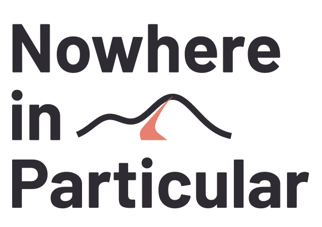

  <picture>
    <source media="(prefers-color-scheme: dark)" srcset="assets/logo-light.svg">
    
  </picture>

# Nowhere in Particular: downloads

A calm exploration game set in real places, built from open data.
Website, the free browser demo and the guide: **https://nowhereinparticular.emdzej.pl**

This repository holds only the public downloads, attached to its
[releases](https://github.com/emdzej/nowhereinparticular-releases/releases). There's no source here.

| Download | What |
|---|---|
| `nowhereinparticular-<version>-<platform>.zip` | The game's free demo (Głowno, Poland) for macOS, Windows and Linux |
| `nowhereinparticular-tools-<version>-<platform>.zip` | The map editor and the mod tools, a workspace with Głowno ([guide](https://nowhereinparticular.emdzej.pl/guide/editor)) |
| `hello-mods-<version>.zip` | An example mod to start from ([mods](https://nowhereinparticular.emdzej.pl/docs/mods)) |
| `nip-roam-<version>-<platform>` | Your own roam server: host your own, like in the old days, no cloud required |
| `SHA256SUMS.txt` | Checksums of every file in the release |

The latest of each: `https://github.com/emdzej/nowhereinparticular-releases/releases/latest`.

Credits and licences for the data, models and sounds: https://nowhereinparticular.emdzej.pl/docs/data
(each bundle has its own `ATTRIBUTION.txt`). Map data © OpenStreetMap contributors, ODbL.

Problems: the game's phone has a Support app, or see the website.
